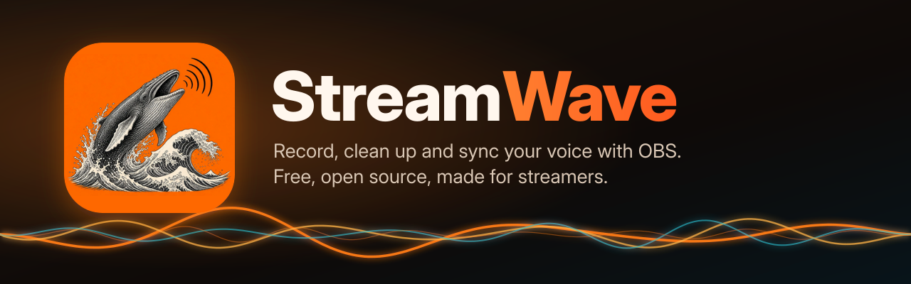
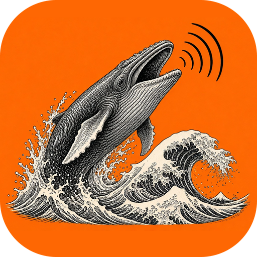
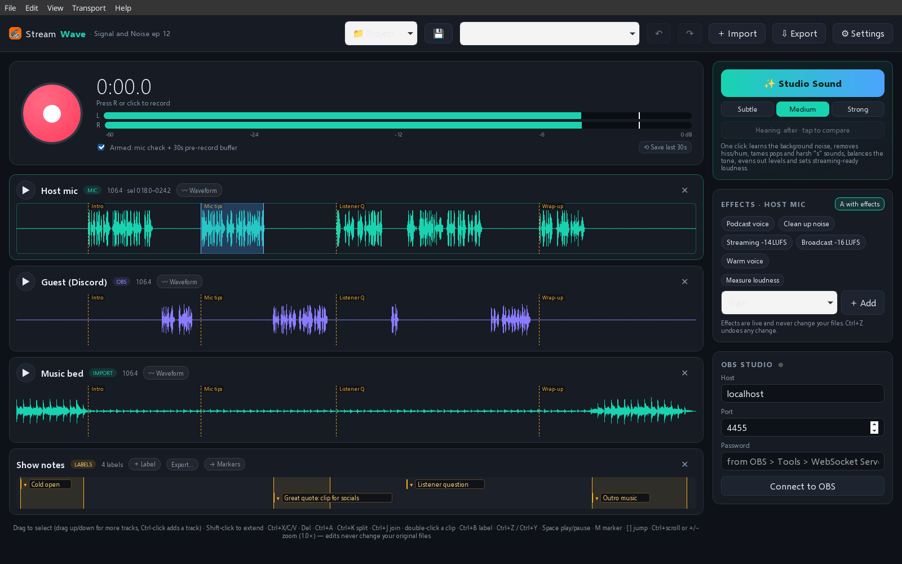
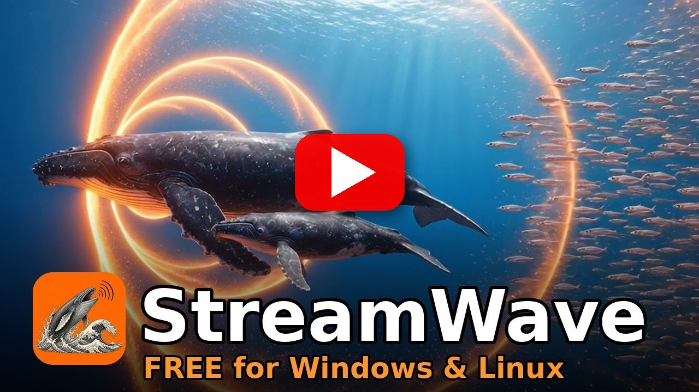
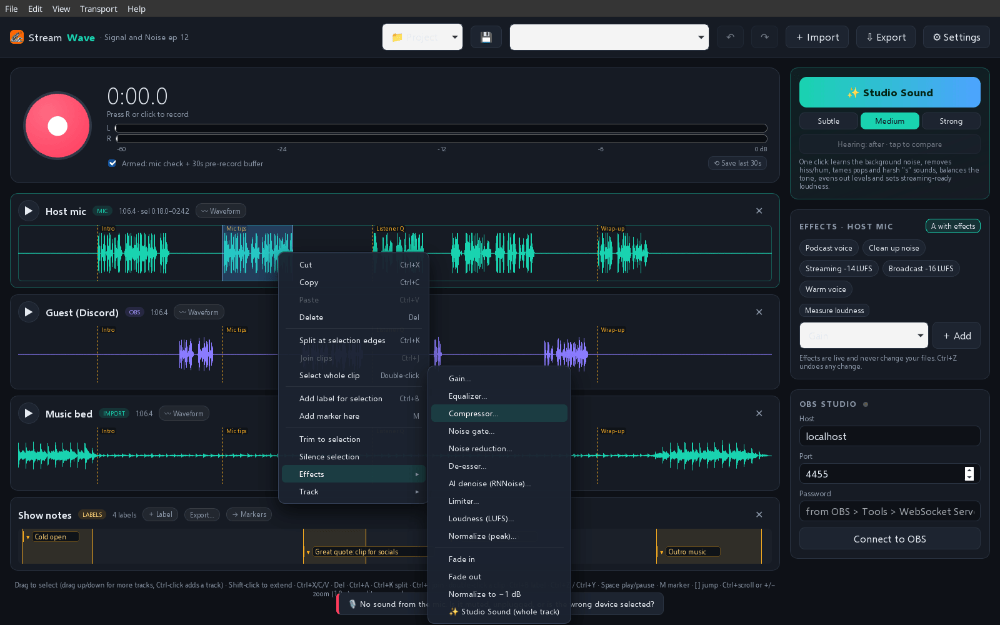
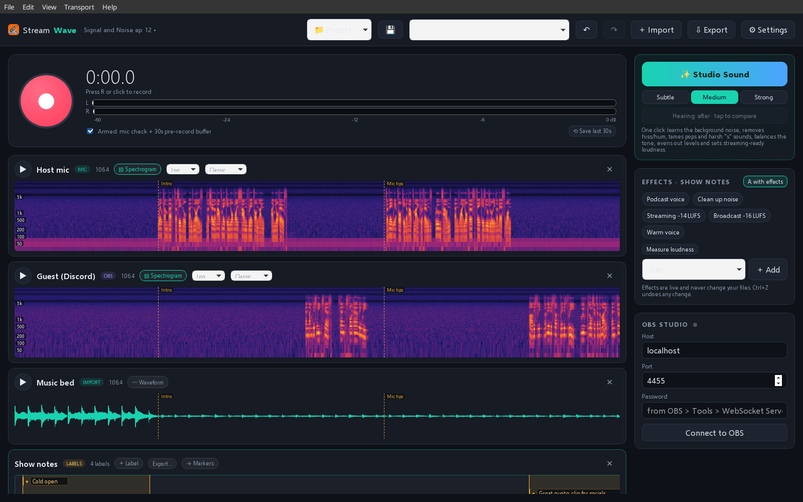
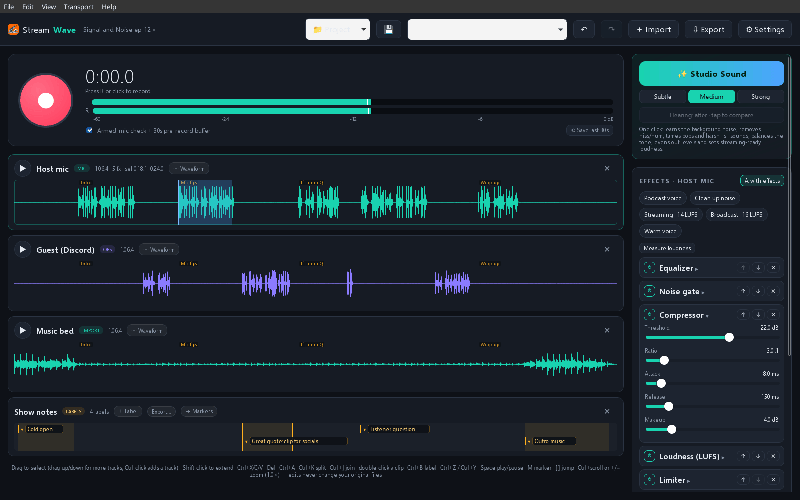
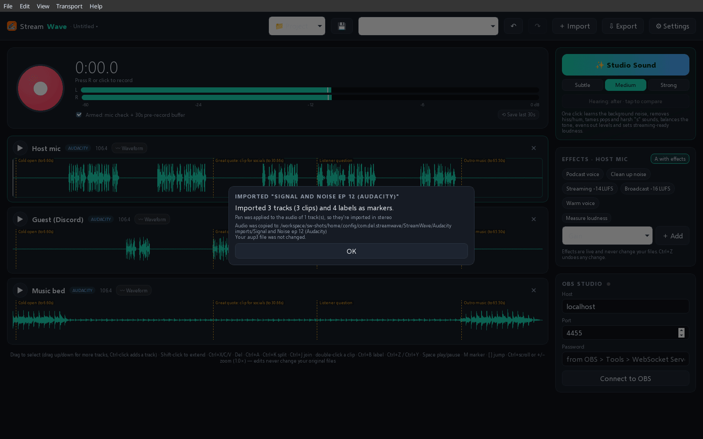
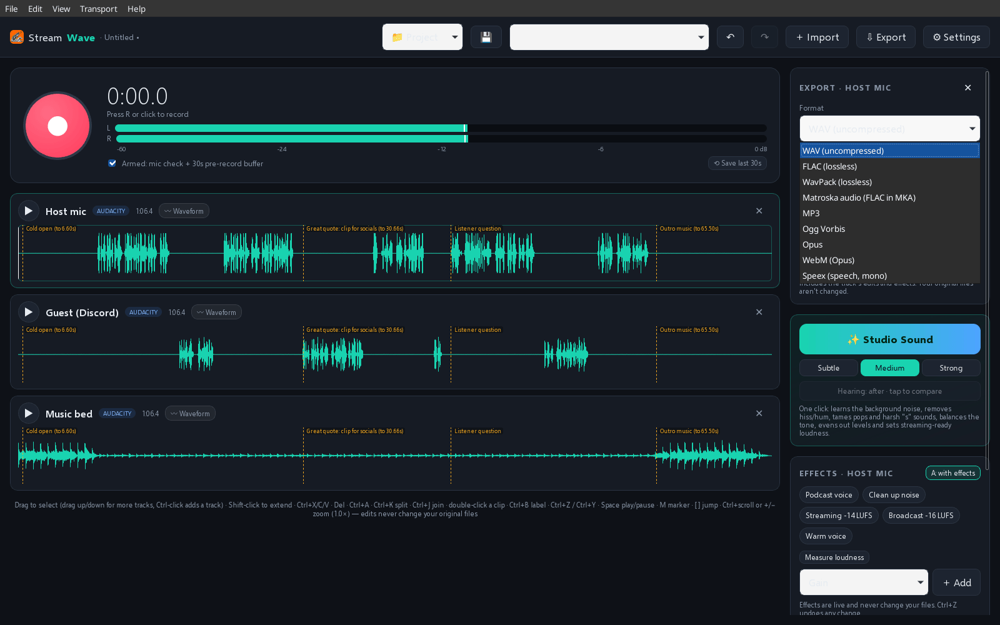
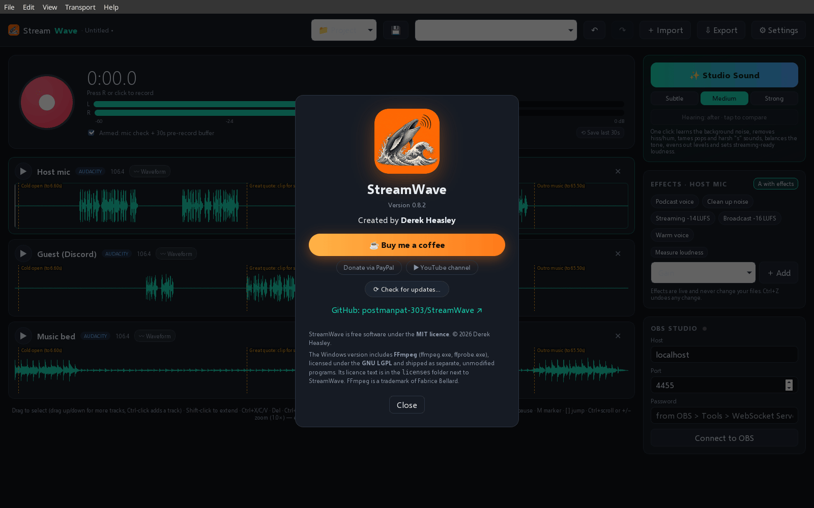

<p align="center">
  
</p>

<p align="center">
  <a href="https://github.com/postmanpat-303/StreamWave/releases/latest"></a>
  <a href="https://github.com/postmanpat-303/StreamWave/actions/workflows/ci.yml"></a>
  
  
  <a href="LICENSE"></a>
  <a href="https://buymeacoffee.com/postmanpat"></a>
  <a href="https://www.youtube.com/@whatgoesaround1551"></a>
</p>

<p align="center">
  <br>
  <b>The audio recorder & editor for streamers, podcasters and voice people.</b><br>
  One button to record. One click to sound like a studio. Locked to OBS.
</p>

<p align="center">
  <a href="https://github.com/postmanpat-303/StreamWave/releases/latest"><b>⬇ Download for Windows / Linux</b></a> ·
  <a href="https://postmanpat-303.github.io/StreamWave/">Website</a> ·
  <a href="GUIDE.md">User guide</a> ·
  <a href="CHANGELOG.md">Changelog</a>
</p>

<p align="center">
  <a href="https://buymeacoffee.com/postmanpat"></a>
  <a href="https://paypal.me/derekh100"></a>
  <a href="https://www.youtube.com/@whatgoesaround1551"></a>
</p>

<p align="center">
  <a href="assets/screenshots/01-main.png"></a>
</p>

## ▶ Watch the promo

<p align="center">
  <a href="https://youtu.be/ZGsCz0rjXeg"></a><br>
  <a href="https://youtu.be/ZGsCz0rjXeg"><b>▶ Watch the StreamWave promo on YouTube</b></a> · more demos on <a href="https://www.youtube.com/@whatgoesaround1551">Derek's YouTube channel</a>
</p>

---

## Why StreamWave?

Most audio editors were designed for studios twenty years ago. StreamWave is built around how creators actually work: OBS is running, Discord is open, the mic is shared, and you want a clean voice track *now* without learning signal-processing jargon.

## ✨ Highlights

| | |
|---|---|
| 🎥 **OBS sync** | Connects to OBS 28+ over obs-websocket. Start/pause/stop together, scene changes become markers, multi-track OBS recordings are auto-imported as separate tracks (mic, desktop, Discord), and **Send back to video** puts your cleaned-up audio into a copy of the video without re-encoding the picture. Auto-reconnects if OBS restarts. |
| 🪄 **Studio Sound** | One click analyses your voice (noise floor, tone, sibilance, plosives, room echo, loudness) and builds a real, editable chain: noise reduction, optional AI denoise (RNNoise), EQ toward a voice curve, de-esser, compressor and **-16 LUFS** loudness through a peak-safe limiter. Subtle / Medium / Strong, with before/after. |
| ⏪ **Never miss a take** | A rolling buffer (up to 60 s) keeps listening while armed. Said something great before you hit record? **Save last 30 s.** |
| 🎛 **Live effects** | EQ, compressor, gate, noise reduction, de-esser, limiter, loudness, fades. Every slider and A/B toggle is heard **instantly during playback**, and export renders through the exact same engine, so what you hear is what you get (tested bit-for-bit). |
| 🛟 **Crash-safe recording** | Takes are streamed to disk and the header is refreshed every half second. Power cut? Crash? The recording is repaired and offered back at the next start. Unplugged USB mic? The take so far is saved. |
| 📦 **All open formats** | Import Audacity 3 projects (`.aup3`, read-only), WAV, FLAC, MP3, Ogg, Opus, AAC/M4A, AIFF and the audio inside MP4/MKV. Export WAV (16/24/32-bit float), FLAC, WavPack, MP3, Ogg Vorbis, Opus, WebM, MKA, with tags. |
| 🤝 **Shared mic, always** | StreamWave **never takes exclusive control** of your microphone. OBS, Discord and your browser keep working with the same mic at the same time. |
| ✂️ **Non-destructive editing** | Cut, copy, paste and delete with full undo history; your original files are never touched. Select across several tracks and edit them together, split (**Ctrl+K**) and join (**Ctrl+J**) clips. `.twt` project files with autosave and crash recovery. |
| 🌈 **Spectrogram view** | Switch any track between waveform and spectrogram, with a log or linear frequency scale and Classic, Inferno or Greyscale colours. Good for spotting hum, hiss and plosives. |
| 🏷 **Label tracks** | **Ctrl+B** adds an editable text label at the cursor or selection. Export labels as Audacity-compatible text or turn them into markers/chapters. |
| 🩺 **Live mic check** | Friendly warnings for clipping, too quiet, dead channel, DC offset and 50/60 Hz hum, before they ruin a recording. |

## 📸 Screenshots

*Real screenshots of StreamWave 0.8.2 on Linux, using a demo episode with self-generated voice and music. Click any image for full size.*

<table>
<tr>
<td width="50%" valign="top"><a href="assets/screenshots/02-context-menu.png"></a><br><b>Right-click anything.</b> Cut, split, label or apply an effect straight to the selection.</td>
<td width="50%" valign="top"><a href="assets/screenshots/03-spectrogram.png"></a><br><b>Spectrogram view.</b> Spot hum, hiss and plosives at a glance, with a log or linear scale.</td>
</tr>
<tr>
<td width="50%" valign="top"><a href="assets/screenshots/04-effects.png"></a><br><b>Live effects chain.</b> One-click presets build an editable chain that you hear instantly while it plays.</td>
<td width="50%" valign="top"><a href="assets/screenshots/05-aup3-import.png"></a><br><b>Bring your Audacity projects.</b> <code>.aup3</code> tracks and labels come across; your original file is only read.</td>
</tr>
<tr>
<td width="50%" valign="top"><a href="assets/screenshots/06-export.png"></a><br><b>Export to open formats.</b> WAV, FLAC, WavPack, MP3, Ogg, Opus, WebM and more, with tags.</td>
<td width="50%" valign="top"><a href="assets/screenshots/07-about.png"></a><br><b>Free and open source.</b> Made by Derek Heasley. If it saves you time, <a href="https://buymeacoffee.com/postmanpat">buy me a coffee</a> ☕</td>
</tr>
</table>

## ⬇ Install

### Windows 10/11
1. Download **`StreamWave_<version>_x64-setup.exe`** from [Releases](https://github.com/postmanpat-303/StreamWave/releases/latest).
2. Run it. No admin rights are needed; it installs for your user only. FFmpeg is included.
3. **SmartScreen:** the installer isn't code-signed yet, so Windows may say *"Windows protected your PC"*. Click **More info → Run anyway**.

### Linux
Download **`StreamWave_<version>_amd64.AppImage`**, then:
```bash
chmod +x StreamWave_*_amd64.AppImage
./StreamWave_*_amd64.AppImage
```
Install FFmpeg from your distro (`sudo apt install ffmpeg`, `sudo dnf install ffmpeg-free`, `sudo pacman -S ffmpeg`) for formats other than WAV and for OBS video files. Audio works through PipeWire, PulseAudio or JACK.

### Updates
From 0.6.0 on, StreamWave can update itself. Use **Help → Check for updates…** (or the button in About). It shows what's new and only downloads when you click **Download & install**. A quiet check also runs at startup, at most once a day, and you can turn it off in Settings. Updates are signed and verified before they're installed.
The Windows installer and the AppImage can self-update. The `.deb` cannot, so update it from Releases. **0.5.x has no updater, so install 0.6.0 by hand once.**

### Connect OBS
In OBS: **Tools → WebSocket Server Settings → Enable WebSocket server**, copy the password, and paste it into StreamWave's first-run setup (or the OBS panel).

## 🛠 Build from source

Prerequisites: [Rust](https://rustup.rs) (stable), [Node.js](https://nodejs.org) 20+, and the [Tauri prerequisites](https://tauri.app/start/prerequisites/) for your OS (Windows: Visual Studio Build Tools 2022 with "Desktop development with C++"; Linux: WebKitGTK 4.1, ALSA dev headers).

```bash
git clone https://github.com/postmanpat-303/StreamWave.git
cd StreamWave
npm install
npm run tauri dev      # run with hot reload
npm test               # frontend tests
cd src-tauri && cargo test --lib   # audio engine & DSP tests
npm run tauri build    # installers in src-tauri/target/release/bundle
```

Optional cargo features: `asio` (Steinberg ASIO on Windows) and `jack` (Linux). See the [user guide](GUIDE.md) for ASIO setup, bundling FFmpeg, and all keyboard shortcuts. Release builds can be run by hand from GitHub Actions ([`.github/workflows/release.yml`](.github/workflows/release.yml), *Run workflow*). They produce a draft release.

**Updater signing (maintainers):** release builds are signed for the in-app updater with a minisign key made by `npx tauri signer generate`. The public key is in `src-tauri/tauri.conf.json` (`plugins.updater.pubkey`). The private key is **never** committed. To build updater artifacts (`.sig` files) locally, set `TAURI_SIGNING_PRIVATE_KEY` (the key file path or its contents) and `TAURI_SIGNING_PRIVATE_KEY_PASSWORD`, then build with `--config src-tauri/tauri.windows-installer.conf.json` (Windows) or `--config src-tauri/tauri.updater.conf.json` (AppImage). Plain `npm run tauri build` doesn't need the key. For the GitHub release workflow, add both values as repository secrets with those names. Each release must attach a `latest.json` listing the `windows-x86_64` setup .exe and `linux-x86_64` AppImage with their signatures, because the app reads it from `releases/latest/download/latest.json`.

**Stack:** Tauri 2 · Rust (cpal, symphonia, hound, rtrb lock-free rings, obws, ebur128, rustfft, nnnoiseless) · Svelte 5 + TypeScript + Vite.

## 🗺 Roadmap

- [ ] **Edit by text**: transcribe locally, delete words in the transcript to cut the audio
- [ ] **Voice / music separation**: pull your voice out of a stream recording with game audio or music
- [ ] **Auto-chapters**: chapter markers from topic changes and OBS scenes, exported to YouTube timestamps
- [ ] **VST3 / CLAP plugin hosting**: use your favourite plugins in the live chain
- [ ] Multi-track mixing view, clip fades and crossfades
- [x] In-app update check (0.6.0)
- [x] Audacity 3 (`.aup3`) project import (0.7.0)
- [x] Spectrogram view, multi-track selection, label tracks, split / join clips (0.8.0)
- [x] Right-click menu with effects on a selection; browser menu and shortcuts switched off (0.8.1)
- [ ] Code-signed Windows installer, Flatpak, macOS build

Ideas welcome; please open an issue.

## ❓ FAQ

**Will it fight OBS or Discord for my microphone?**
No. StreamWave only ever opens devices in shared mode (WASAPI shared on Windows; PipeWire/PulseAudio/JACK routes on Linux). Everything keeps working side by side.

**Does it change my original recordings?**
Never. Edits and effects are stored in the project; the source files are only read.

**What happens if it crashes while I'm recording?**
The recording is written continuously with a header that is refreshed twice a second. On the next start it is repaired and added back automatically.

**Why is the installer flagged by SmartScreen?**
It isn't code-signed yet (certificates cost money). Click **More info → Run anyway**. The source and the CI build are public, so you can check exactly what you're installing.

**Do I need FFmpeg?**
The Windows installer includes it. On Linux, install it from your distro. Without FFmpeg you can still record, edit and export WAV.

**Can StreamWave replace Audacity?**
If you've used Audacity, you'll feel at home, with live effects, OBS sync and recordings that survive a crash.
For recording, cleaning up and editing voice, podcasts and stream audio, it can be all you need. It is not a full replacement, though. Audacity has many years of features StreamWave doesn't have: plug-in effects (VST, LV2, Nyquist), spectral editing (StreamWave shows a spectrogram but doesn't edit in it), macros, MIDI and a much larger set of built-in effects and analysis tools. StreamWave can select and edit several tracks together, but it plays and exports one track at a time rather than mixing a full multitrack session.
You can bring existing work across: **File → Import Audacity Project…** (or drag an `.aup3` onto the window) reads Audacity 3 projects. Tracks, names, clip positions and trims, the audio itself (16-bit, 24-bit and 32-bit float), track gain, pan, mute and solo, clip envelopes and labels (as markers) come across. Audacity effects and note/time tracks are skipped, and StreamWave tells you exactly what it left out. Your `.aup3` file is opened read-only and never changed; the audio is copied into WAV files next to your StreamWave project (or into your recordings folder under *Audacity imports* if the project isn't saved yet).
*Audacity® is a trademark of its respective owners. StreamWave is an independent project and isn't affiliated with or endorsed by Audacity or Muse Group. The importer was written from scratch and contains no Audacity code.*

**Is there a Mac version?**
Not yet. Tauri supports macOS, so it's on the roadmap.

**Is it really free?**
Yes, MIT-licensed, no accounts, no telemetry, everything runs locally.

## ☕ Support

StreamWave is free and built in spare time by **Derek Heasley**. If it saves you time on stream, you can [**buy me a coffee**](https://buymeacoffee.com/postmanpat) (or [donate via PayPal](https://paypal.me/derekh100)). Demos and promos for my apps are on [YouTube](https://www.youtube.com/@whatgoesaround1551). Thank you! Bug reports and ideas in [Issues](https://github.com/postmanpat-303/StreamWave/issues) help just as much.

## 📄 Licence

StreamWave is © 2026 Derek Heasley and released under the [MIT Licence](LICENSE).

The Windows installer bundles **FFmpeg** (`ffmpeg.exe`, `ffprobe.exe`), an LGPL build from [BtbN/FFmpeg-Builds](https://github.com/BtbN/FFmpeg-Builds), as separate, unmodified programs. FFmpeg is licensed under the **GNU LGPL** (not MIT). Its licence text and source links are installed in the `licenses` folder next to StreamWave, and you can replace those binaries with any other FFmpeg build. FFmpeg is a trademark of Fabrice Bellard. RNNoise (via `nnnoiseless`) is BSD-3-Clause; other Rust/npm dependencies keep their own permissive licences.

## 💛 Thank you

A big thank you to [storytold](https://github.com/storytold/), whose open-source [PhotoCraft](https://github.com/storytold/photocraft) inspired the look of the Wave family icons, and whose [ArtCraft Launcher](https://github.com/storytold/craft-launcher) inspired the upcoming Wave Hub. Open source at its best. Go give them a ⭐!
